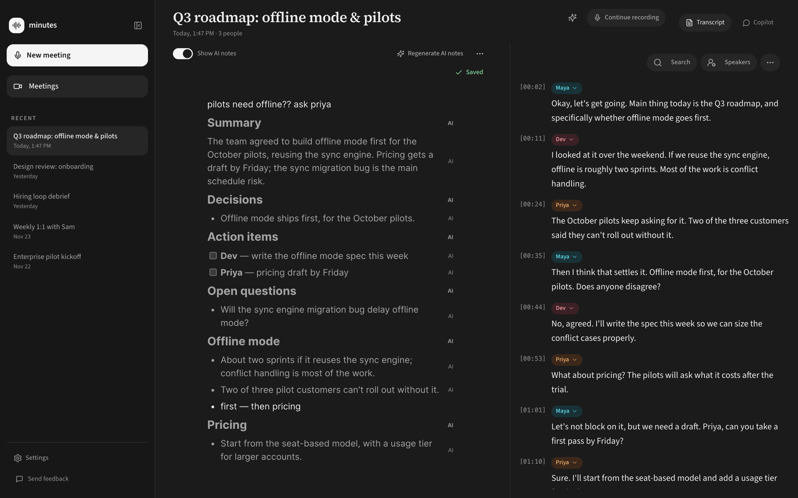
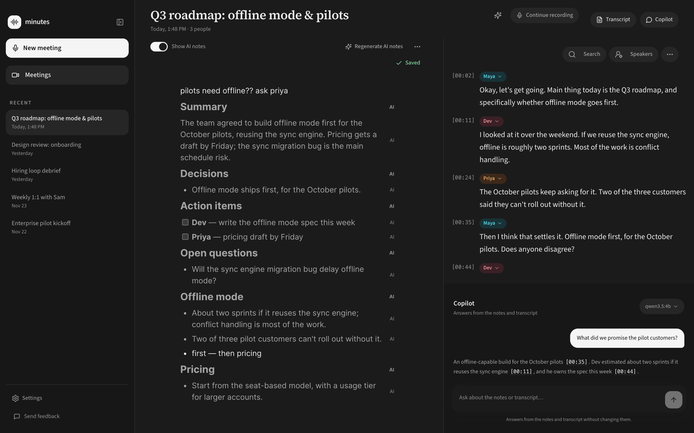
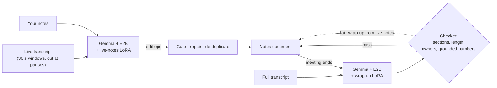
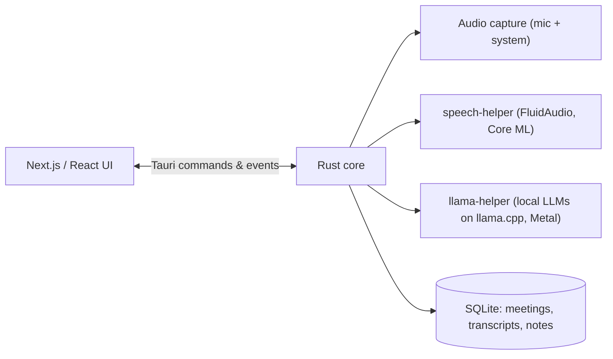

<p align="center">
  
</p>

<h3 align="center">The meeting notetaker that never leaves your Mac.</h3>

<p align="center">
  Minutes records your meetings, transcribes them on-device, and writes notes <i>while people talk</i>,<br/>
  in the same document as yours. No bot in the call. No cloud. No account. Free and open source.
</p>

<p align="center"><b>Install on an Apple Silicon Mac</b> by pasting this into Terminal:</p>

```bash
curl -fsSL https://praveenvnktsh.github.io/minutes/install.sh | bash
```

<p align="center">
  <a href="https://github.com/praveenvnktsh/minutes/releases/latest"></a>
  
  
  <a href="https://github.com/praveenvnktsh/minutes/stargazers"></a>
</p>

<p align="center"><b><a href="https://praveenvnktsh.github.io/minutes/">Website</a></b> · <a href="#install">Install</a> · <a href="#how-it-works">How it works</a> · <a href="#the-models">The models</a> · <a href="#faq">FAQ</a> · <a href="#build-from-source">Build from source</a></p>

---

<p align="center">
  
</p>

## Why Minutes

Most AI notetakers join your call as a bot, upload the audio to someone else's servers, and send a generic report an hour later. Minutes takes the other approach:

- **🔒 Nothing leaves your Mac.** Transcription, speaker identification and the note-taking models all run locally on Apple Silicon. It works in airplane mode. There's no account and no telemetry.
- **✍️ Notes appear while people are still talking.** A 2B-parameter model [fine-tuned for one job](#the-models), keeping meeting notes current, adds topics, points and decisions at each pause in the conversation, right next to what you type. It never rewrites your lines.
- **🫥 No bot in the call.** Minutes records your microphone and your computer's audio, so it works with Zoom, Meet, Teams, Slack huddles, or anything else that plays sound. Nobody else sees a "notetaker has joined" message.
- **🧾 A wrap-up when you stop.** Summary, decisions, action items with owners, and open questions, checked against the transcript before you see them.
- **💸 Free, forever.** MIT-licensed, with no subscription and no per-seat pricing.

## How it works

1. **Hit record** (or accept the prompt when Minutes notices a meeting starting). Your mic and system audio are captured and mixed so neither drowns out the other.
2. **Notes write themselves.** At each pause in the conversation (roughly every 30 seconds), a [fine-tuned Gemma 4 E2B](#the-models) makes a few small edits to the notes: a new topic, a point, a decision, or a fix to its own earlier line. AI lines are marked as its own, and one switch hides them.
3. **Stop, and get the wrap-up.** A second fine-tuned adapter turns the live notes and your own into a summary, decisions, action items and open questions. Anything the live notes missed is filled in from the transcript first. Minutes also names the meeting, unless you've already renamed it.
4. **Ask your meeting.** Copilot chats over the transcript and your notes, during the call or long after it: "what did we promise the pilot customers?"

<p align="center">
  
  
</p>

## Features

| | |
| --- | --- |
| **Capture** | Microphone + system audio with mixing and clipping protection · meeting detection with a one-click prompt · optional menu-bar recording indicator · pause and resume · import existing audio files |
| **Transcription** | Live streaming transcript (NVIDIA Nemotron), or transcribe after the call to keep the laptop cool · high-accuracy final pass (Parakeet TDT v2) · on-device speaker diarization with a speaker manager to name and reassign people · full-text search across every meeting |
| **Notes** | One document for your notes and the AI's · live AI notes during the meeting · wrap-up with summary, decisions, action items and open questions · editable after the meeting, side by side with the transcript · copy and export |
| **AI models** | Built-in local models (nothing to install) · [Ollama](https://ollama.com) · optional Claude, Groq or OpenRouter with your own key |
| **App** | Native Tauri + Rust app · light and dark themes · signed automatic updates · everything stored in a local SQLite database you own |

## The models

Minutes' notes come from two LoRA adapters on **Google's Gemma 4 E2B**, trained specifically for meetings. Both are [open on Hugging Face](https://huggingface.co/praveenvnktsh00) under Apache 2.0.

**Why fine-tune instead of prompting a bigger model?** Live notes have to run on a laptop *at the same time as* live transcription and your video call, every 30 seconds, for an hour. A general model asked to "update these notes" rewrites everything, narrates ("the team then discussed…"), and is too slow on-device. A model small enough to keep up doesn't follow the format without training: untuned Gemma 4 E2B passed the wrap-up's format checks on **0 of 10** test meetings. The fine-tuned adapter passes **8 of 10**.



### Live notes: [`minutes-notes-gemma4-e2b`](https://huggingface.co/praveenvnktsh00/minutes-notes-gemma4-e2b)

The model doesn't write prose. It reads the current notes, your own notes and the newest window of transcript, and answers with a few compact **edit operations**, usually under 100 tokens:

```text
T=Offline mode                                                    ← new topic
+d 00:35|Offline mode ships first, for the October pilots         ← a decision
+p 00:11|About two sprints if it reuses the sync engine           ← a point
>4 p 00:24|Two of three pilot customers need it to roll out       ← a sub-bullet of note 4
~2|Pricing draft due Friday; seat-based with a usage tier         ← fix its own earlier note
.                                                                 ← nothing worth noting (most windows)
```

Because the output is tiny, it keeps up in real time next to transcription. The app adds three runtime rules the model was evaluated with:
- **Gated silence.** It answers "nothing to note" only when it's at least 90% sure.
- **Sub-bullet repair.** An invalid sub-bullet becomes a plain note instead of being dropped.
- **Duplicate filtering.** Notes that repeat an existing line, or one of yours, are dropped.

It can edit or drop only its own lines. Yours are marked `[you]`, and it may only expand your shorthand with sub-bullets.

- **Training data:** 45 meetings from the [AMI Meeting Corpus](https://groups.inf.ed.ac.uk/ami/corpus/), cut into 30-second windows, with a simulated person typing their own notes. Each window was labelled with the edits a careful notetaker would make, by Claude Opus following a written style guide. A rule-based validator checked every label: numbers must appear in the transcript, no narration, short headlines, sensible topic timing, no duplicates.
- **Training:** LoRA rank 16 on all layers with MLX-LM, about 2 hours on one 24 GB Apple Silicon Mac.
- **Evaluation:** run *closed loop* on 10 held-out meetings, the way the app runs it, where the model works through a whole meeting building on its own notes. **86%** of its edits pass the validator and **88%** of windows are clean. It finds 5.2 topics per meeting, against 6.8 in the reference notes.

### Wrap-up: [`minutes-tidy-gemma4-e2b`](https://huggingface.co/praveenvnktsh00/minutes-tidy-gemma4-e2b)

When the meeting ends, a second adapter on the same base model reads the live notes, your notes and the full transcript. It writes the **Summary, Decisions, Action items (with owners), sections by subject, and Open questions**, with the length scaled to the meeting (about 570 words for 40 minutes). A checker in the app verifies the sections, the length, the owners, and that every number appears in the transcript. If the check fails, Minutes builds a simpler wrap-up straight from the live notes rather than show you an unchecked one. An action item's owner is only named when someone in the meeting actually said it.

- **Training data:** all 138 AMI meetings with transcripts. Opus wrote the references against a written guide, and AMI's human summaries were used to spot-check them. The inputs are the notes the live model *actually produced*, so the wrap-up learns to fix its mistakes.
- **Training:** a one-hour meeting is a 15,000-token input, which normally won't fit for training on a 24 GB Mac. The backward pass runs one decoder layer at a time, with attention and MLP in chunks, which keeps peak memory at 13 GB. Training took 4 hours on one Mac.
- **Evaluation:** on 10 held-out meetings it passes the checker on 8 of 10. Both misses were a few words over the length cap. The untuned base model passed 0 of 10, and the Opus references 10 of 10. A wrap-up takes about 20–30 seconds on an M5.

The app loads Gemma 4 E2B once (as a Q4_K_M GGUF on llama.cpp with Metal) and switches between the two adapters.

### Speech

Speech runs through [FluidAudio](https://github.com/FluidInference/FluidAudio) on Core ML, mostly on the Neural Engine:
- NVIDIA **Nemotron** streams the live transcript.
- **Parakeet TDT v2** does the final high-accuracy pass.
- **Silero** VAD keeps silence away from the models.
- **pyannote** separates speakers.

## Install

**Requirements:** an Apple Silicon Mac (M1 or later) on macOS 15 or later. The app opens on macOS 13 and 14, but transcription needs 15.

Paste this into Terminal:

```bash
curl -fsSL https://praveenvnktsh.github.io/minutes/install.sh | bash
```

It downloads the latest release from GitHub, puts Minutes in your Applications folder (or `~/Applications` if you can't write to `/Applications`), and opens it. Run it again any time to reinstall. The app also updates itself. [Read the script](site/install.sh) first if you like; it's short.

**After it opens:**

1. Grant **Microphone** and **Screen & System Audio Recording** permissions when asked. macOS requires the second one to capture call audio. Minutes doesn't record your screen.
2. Let Minutes download its models. Speech models and the built-in AI are a few GB in total, downloaded once from Hugging Face.

After that, updates are signed and install automatically. Windows and Linux are not supported.

## FAQ

<details>
<summary><b>Does anything get sent to the cloud?</b></summary>

No, unless you choose to. Audio, transcripts and notes stay on your disk. The only network requests are model downloads from Hugging Face and update checks against GitHub Releases. If you add a Claude, Groq or OpenRouter key, the meeting content you send to that provider goes to it, and only to it. See the [privacy policy](PRIVACY_POLICY.md).
</details>

<details>
<summary><b>Does it join my call or tell other people they're being recorded?</b></summary>

It doesn't join anything. Minutes records audio on your own machine, the same audio you hear. Whether and how you tell others is up to you; recording-consent laws vary by place, so check the ones that apply to you.
</details>

<details>
<summary><b>Which meeting apps does it work with?</b></summary>

Any app that plays audio on your Mac: Zoom, Google Meet, Microsoft Teams, Slack, Discord, FaceTime, a browser tab, or an in-person meeting picked up by your mic.
</details>

<details>
<summary><b>Why a Terminal command instead of a download button?</b></summary>

Minutes isn't notarized by Apple yet; that needs a paid developer account this project doesn't have. A browser download gets marked as "from the internet", and macOS then refuses to open the app without a detour through System Settings. A file fetched with `curl` doesn't get that mark, so the one-line install just works. The app is ad-hoc signed, its updates are signed with the project's updater key, and you can [read the installer](site/install.sh) or [build from source](#build-from-source) instead.
</details>

<details>
<summary><b>How heavy is it?</b></summary>

Live transcription and live notes run together on the Neural Engine and GPU, and Apple Silicon handles both alongside a video call. On an older or busy machine, turn off live transcription and Minutes will transcribe after the meeting instead.
</details>

<details>
<summary><b>Intel Macs, Windows, Linux?</b></summary>

No. Minutes is built around Apple Silicon (Core ML, Metal, ScreenCaptureKit), and the code doesn't build for other platforms.
</details>

## Build from source

You need an Apple Silicon Mac with Rust, Node.js, pnpm 9.15.9 and Xcode 16 or later (selected with `xcode-select`).

```bash
git clone https://github.com/praveenvnktsh/minutes.git
cd minutes/frontend
pnpm install --frozen-lockfile
bash ../speech-helper/build.sh debug   # stage the speech sidecar
pnpm tauri:dev
```

To build a local release bundle, run `pnpm tauri:build:local:mac`. See [docs/BUILDING.md](docs/BUILDING.md) for details and [docs/architecture.md](docs/architecture.md) for how the pieces fit.



## Contributing

Bug reports, ideas and pull requests are welcome. Start with [CONTRIBUTING.md](CONTRIBUTING.md). The app's **Send feedback** button opens a prefilled issue.

## License and acknowledgments

Minutes is [MIT licensed](LICENSE.md). It started as a fork of [Meetily](https://github.com/Zackriya-Solutions/meeting-minutes) by Zackriya Solutions, whose copyright notice is retained, and has since been substantially rewritten. Third-party code and models keep their own licenses.

Built on [FluidAudio](https://github.com/FluidInference/FluidAudio), [Tauri](https://tauri.app), [llama.cpp](https://github.com/ggml-org/llama.cpp), [Screenpipe](https://github.com/mediar-ai/screenpipe), NVIDIA's Nemotron and Parakeet speech models, Google's Gemma 4, and the [AMI Meeting Corpus](https://groups.inf.ed.ac.uk/ami/corpus/).
