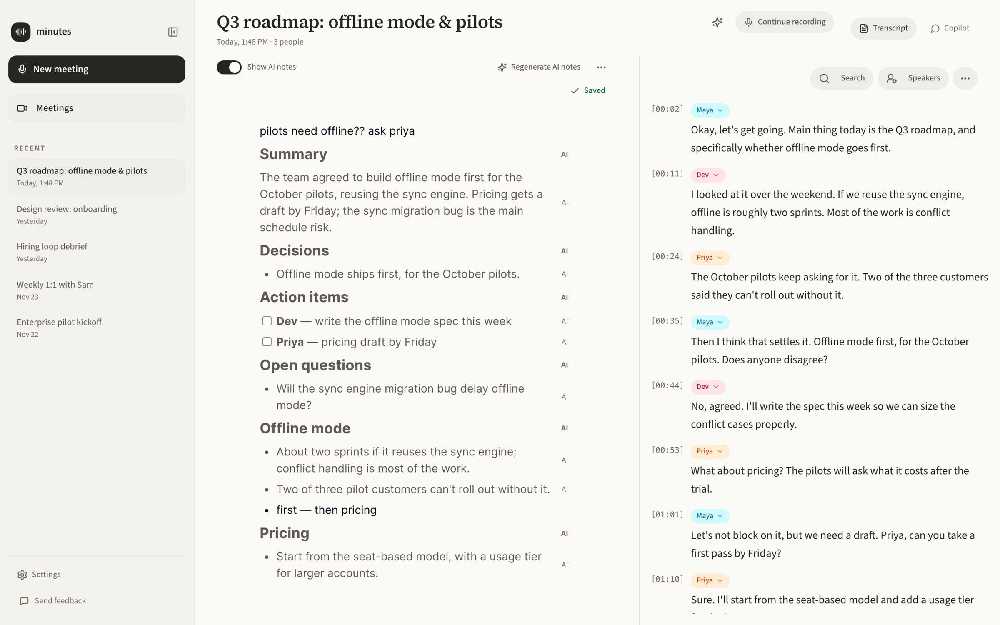
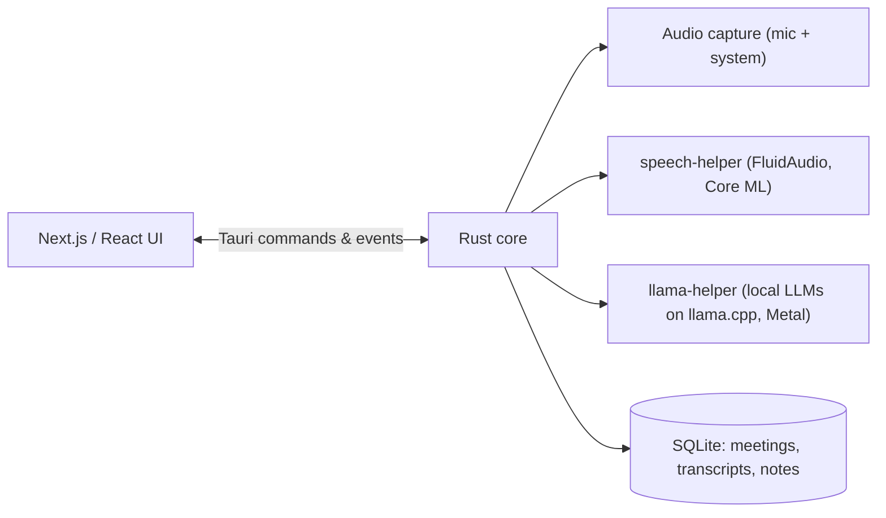

<p align="center">
  
</p>

<h3 align="center">The meeting notetaker that never leaves your Mac.</h3>

<p align="center">
  Minutes records your meetings, transcribes them on-device, and writes notes <i>while people talk</i>,<br/>
  in the same document as yours. No bot in the call. No cloud. No account. Free and open source.
</p>

<p align="center">
  <a href="https://github.com/praveenvnktsh/minutes/releases/latest/download/minutes-macos-arm64.dmg"></a>
</p>

<p align="center">
  <a href="https://github.com/praveenvnktsh/minutes/releases/latest"></a>
  
  
  <a href="https://github.com/praveenvnktsh/minutes/stargazers"></a>
</p>

<p align="center"><b><a href="https://praveenvnktsh.github.io/minutes/">Website</a></b> · <a href="#install">Install</a> · <a href="#how-it-works">How it works</a> · <a href="#faq">FAQ</a> · <a href="#build-from-source">Build from source</a></p>

---

<p align="center">
  
</p>

## Why Minutes

Most AI notetakers join your call as a bot, upload the audio to someone else's servers, and send a generic report an hour later. Minutes takes the other approach:

- **🔒 Nothing leaves your Mac.** Transcription, speaker identification and the note-taking models all run locally on Apple Silicon. It works in airplane mode. There's no account and no telemetry.
- **✍️ Notes appear while people are still talking.** A small model fine-tuned for meeting notes adds topics, points and decisions every few seconds, right next to what you type. It never rewrites your lines.
- **🫥 No bot in the call.** Minutes records your microphone and your computer's audio, so it works with Zoom, Meet, Teams, Slack huddles, or anything else that plays sound. Nobody else sees a "notetaker has joined" message.
- **🧾 A wrap-up when you stop.** Summary, decisions, action items with owners, and open questions, checked against the transcript before you see them.
- **💸 Free, forever.** MIT-licensed, with no subscription and no per-seat pricing.

## How it works

1. **Hit record** (or accept the prompt when Minutes notices a meeting starting). Your mic and system audio are captured and mixed so neither drowns out the other.
2. **Notes write themselves.** Whenever there's a pause, a fine-tuned Gemma 4 E2B model makes a few small edits to the notes: a new topic, a point, a decision, or a fix to its own earlier line. AI lines are marked as its own, and one switch hides them.
3. **Stop, and get the wrap-up.** A second fine-tuned adapter turns the live notes and your own into a summary, decisions, action items and open questions. Anything the live notes missed is filled in from the transcript first. Minutes also names the meeting, unless you've already renamed it.
4. **Ask your meeting.** Copilot chats over the transcript and your notes, during the call or long after it: "what did we promise the pilot customers?"

<p align="center">
  
  
</p>

## Features

| | |
| --- | --- |
| **Capture** | Microphone + system audio with mixing and clipping protection · meeting detection with a one-click prompt · optional menu-bar recording indicator · pause and resume · import existing audio files |
| **Transcription** | Live streaming transcript (NVIDIA Nemotron), or transcribe after the call to keep the laptop cool · high-accuracy final pass (Parakeet TDT v2) · on-device speaker diarization with a speaker manager to name and reassign people · full-text search across every meeting |
| **Notes** | One document for your notes and the AI's · live AI notes during the meeting · wrap-up with summary, decisions, action items and open questions · editable after the meeting, side by side with the transcript · copy and export |
| **AI models** | Built-in local models (nothing to install) · [Ollama](https://ollama.com) · optional Claude, Groq or OpenRouter with your own key |
| **App** | Native Tauri + Rust app · light and dark themes · signed automatic updates · everything stored in a local SQLite database you own |

### Open models

The note-taking adapters are published on Hugging Face under Apache 2.0, trained on the AMI Meeting Corpus:

- [`minutes-notes-gemma4-e2b`](https://huggingface.co/praveenvnktsh00/minutes-notes-gemma4-e2b): live notes
- [`minutes-tidy-gemma4-e2b`](https://huggingface.co/praveenvnktsh00/minutes-tidy-gemma4-e2b): the wrap-up

Speech runs through [FluidAudio](https://github.com/FluidInference/FluidAudio) on Core ML (Neural Engine and GPU): Nemotron for live text, Parakeet TDT v2 for the final pass, Silero VAD, and pyannote diarization.

## Install

**Requirements:** an Apple Silicon Mac (M1 or later) on macOS 15 or later. The app opens on macOS 13 and 14, but transcription needs 15.

1. Download **[minutes-macos-arm64.dmg](https://github.com/praveenvnktsh/minutes/releases/latest/download/minutes-macos-arm64.dmg)** and drag Minutes into Applications.
2. **First launch:** Minutes isn't notarized by Apple yet, so macOS will say it can't verify the app. Right-click the app and choose **Open**, then **Open** again. Or run this once:
   ```bash
   xattr -dr com.apple.quarantine /Applications/minutes.app
   ```
3. Grant **Microphone** and **Screen & System Audio Recording** permissions when asked. macOS requires the second one to capture call audio. Minutes doesn't record your screen.
4. Let Minutes download its models. Speech models and the built-in AI are a few GB in total, downloaded once from Hugging Face.

After that, updates are signed and install automatically. Windows and Linux are not supported.

## FAQ

<details>
<summary><b>Does anything get sent to the cloud?</b></summary>

No, unless you choose to. Audio, transcripts and notes stay on your disk. The only network requests are model downloads from Hugging Face and update checks against GitHub Releases. If you add a Claude, Groq or OpenRouter key, the meeting content you send to that provider goes to it, and only to it. See the [privacy policy](PRIVACY_POLICY.md).
</details>

<details>
<summary><b>Does it join my call or tell other people they're being recorded?</b></summary>

It doesn't join anything. Minutes records audio on your own machine, the same audio you hear. Whether and how you tell others is up to you; recording-consent laws vary by place, so check the ones that apply to you.
</details>

<details>
<summary><b>Which meeting apps does it work with?</b></summary>

Any app that plays audio on your Mac: Zoom, Google Meet, Microsoft Teams, Slack, Discord, FaceTime, a browser tab, or an in-person meeting picked up by your mic.
</details>

<details>
<summary><b>Why the security warning on first launch?</b></summary>

Apple charges for the developer account needed to notarize apps, and this project doesn't have one yet. The app is ad-hoc signed and its updates are signed with the project's updater key. The full source is here if you'd rather build it yourself.
</details>

<details>
<summary><b>How heavy is it?</b></summary>

Live transcription and live notes run together on the Neural Engine and GPU, and Apple Silicon handles both alongside a video call. On an older or busy machine, turn off live transcription and Minutes will transcribe after the meeting instead.
</details>

<details>
<summary><b>Intel Macs, Windows, Linux?</b></summary>

No. Minutes is built around Apple Silicon (Core ML, Metal, ScreenCaptureKit), and the code doesn't build for other platforms.
</details>

## Build from source

You need an Apple Silicon Mac with Rust, Node.js, pnpm 9.15.9 and Xcode 16 or later (selected with `xcode-select`).

```bash
git clone https://github.com/praveenvnktsh/minutes.git
cd minutes/frontend
pnpm install --frozen-lockfile
bash ../speech-helper/build.sh debug   # stage the speech sidecar
pnpm tauri:dev
```

To build a local release bundle, run `pnpm tauri:build:local:mac`. See [docs/BUILDING.md](docs/BUILDING.md) for details and [docs/architecture.md](docs/architecture.md) for how the pieces fit.



## Contributing

Bug reports, ideas and pull requests are welcome. Start with [CONTRIBUTING.md](CONTRIBUTING.md). The app's **Send feedback** button opens a prefilled issue.

## License and acknowledgments

Minutes is [MIT licensed](LICENSE.md). It started as a fork of [Meetily](https://github.com/Zackriya-Solutions/meeting-minutes) by Zackriya Solutions, whose copyright notice is retained, and has since been substantially rewritten. Third-party code and models keep their own licenses.

Built on [FluidAudio](https://github.com/FluidInference/FluidAudio), [Tauri](https://tauri.app), [llama.cpp](https://github.com/ggml-org/llama.cpp), [Screenpipe](https://github.com/mediar-ai/screenpipe), NVIDIA's Nemotron and Parakeet speech models, Google's Gemma 4, and the [AMI Meeting Corpus](https://groups.inf.ed.ac.uk/ami/corpus/).
