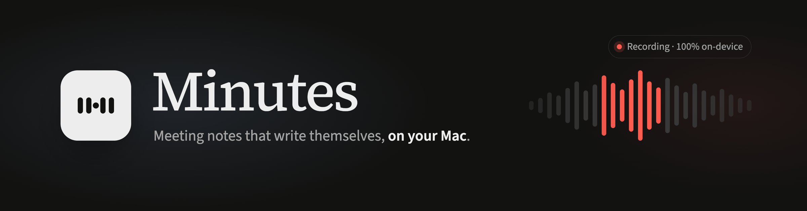

<p align="center">
  
</p>

<p align="center">
  <a href="https://github.com/praveenvnktsh/minutes/releases/latest"></a>
  
  <a href="https://github.com/praveenvnktsh/minutes/stargazers"></a>
</p>

Minutes is an open-source, local alternative to Granola for Mac. It records your calls, transcribes them on your Mac, and a model I fine-tuned takes notes while people are still talking, in the same doc you're typing in. When the call ends you get a summary, decisions, action items and open questions.

Nothing joins the call and nothing gets uploaded. There's no account.

```bash
curl -fsSL https://praveenvnktsh.github.io/minutes/install.sh | bash
```

That's the install. It needs an Apple Silicon Mac on macOS 15 or later. Website: [praveenvnktsh.github.io/minutes](https://praveenvnktsh.github.io/minutes/)

<p align="center">
  
</p>

## Why I built it

I tried every open-source notetaker I could find and they all felt flaky. The cloud ones work well, but they join your calls as a bot and upload everything. I wanted something that ran on my laptop and took notes the way I would, during the meeting, not a generic summary an hour later.

The transcription models are the same good open models other apps use. Where Minutes is different is the live notes and the app around them.

## What it does

- Records your mic and the call audio together. Because nothing joins the call, it works with Zoom, Meet, Teams, Slack, a browser tab, or a meeting in the room.
- Shows the transcript live, or transcribes after the call if you'd rather keep the laptop free. Speakers are separated on-device, and you can rename them.
- Takes notes as the meeting goes. About every 30 seconds it adds topics, points and decisions, marked as AI. You can type your own notes in the same doc and it won't change them. There's a switch to hide the AI lines.
- Writes a wrap-up when you stop: summary, decisions, action items with owners, and open questions. It also names the meeting, unless you already renamed it.
- Copilot answers questions about the transcript and your notes, with timestamps.
- Asks to record when it sees a call starting, imports audio files, and searches across all your transcripts.
- Uses its built-in models by default. Ollama works too, and so do Claude, Groq or OpenRouter if you add a key.

<p align="center">
  
  
</p>

## The models

The notes come from two LoRA adapters I trained on Google's Gemma 4 E2B, a 2B-parameter model. Both are on Hugging Face under Apache 2.0:

- [`minutes-notes-gemma4-e2b`](https://huggingface.co/praveenvnktsh00/minutes-notes-gemma4-e2b) writes the live notes
- [`minutes-tidy-gemma4-e2b`](https://huggingface.co/praveenvnktsh00/minutes-tidy-gemma4-e2b) writes the wrap-up

I fine-tuned instead of prompting a bigger model because a big model is too slow to run next to live transcription on a laptop. It also tends to narrate ("the team then discussed...") instead of taking notes. A model this small doesn't follow the format without training either: plain Gemma 4 E2B passed the wrap-up checks on 0 of 10 test meetings, and the fine-tuned one passes 8.

### Live notes

The live model doesn't write paragraphs. Every 30 seconds or so it reads the current notes, your notes and the latest stretch of transcript, and replies with a few short edits:

```text
T=Offline mode                                              new topic
+d 00:35|Offline mode ships first, for the October pilots   decision
+p 00:11|About two sprints if it reuses the sync engine     point
>4 p 00:24|Two of three pilots need it to roll out          detail under note 4
~2|Pricing draft due Friday; seat-based with a usage tier   fixes one of its own notes
.                                                           nothing new (most of the time)
```

That's usually under 100 tokens, which is why it keeps up. It can only edit its own lines. Your lines are marked as yours in the prompt, and all it can do with them is add detail underneath.

The app applies three rules on top, the same ones used when I evaluated it:
- It only answers "nothing new" when it's at least 90% sure.
- A broken sub-bullet becomes a normal note instead of being dropped.
- Notes that repeat an existing line are skipped.

It was trained on 45 meetings from the [AMI Meeting Corpus](https://groups.inf.ed.ac.uk/ami/corpus/), cut into 30-second windows, with a simulated person typing notes alongside. Claude Opus labelled each window following a style guide I wrote, and a rule-based validator checked every label: numbers have to appear in the transcript, no narration, short lines, no duplicates. Training was LoRA rank 16 with MLX-LM, about 2 hours on one 24 GB Mac.

To test it, I ran it on 10 meetings it hadn't seen, start to finish, building on its own notes the way the app does. 86% of its edits pass the validator, and it finds 5.2 topics per meeting where the reference notes have 6.8.

### Wrap-up

When the meeting ends, the second adapter reads the live notes, your notes and the full transcript. It writes the summary, decisions, action items, sections by subject, and open questions, at a length that scales with the meeting. The app checks the result: the sections have to be there, numbers have to appear in the transcript, and an action item only gets an owner if someone actually said it. If the check fails, you get a simpler wrap-up built from the live notes.

It was trained on all 138 AMI meetings, with references written by Opus against a guide. The inputs are the notes the live model actually wrote, so it learns to clean up after it. An hour-long meeting is about 15,000 tokens, which doesn't normally fit in memory for training on a 24 GB Mac. To make it fit, the backward pass runs one layer at a time. Training took 4 hours.

On 10 held-out meetings it passes the checks on 8. Both misses were a few words over the length limit. It takes about 20 to 30 seconds per meeting on an M5.

Both adapters share the same base model (Q4_K_M, running on llama.cpp with Metal), so the app loads it once and switches adapters.

### Speech

Speech runs through [FluidAudio](https://github.com/FluidInference/FluidAudio) on Core ML, mostly on the Neural Engine:
- NVIDIA Nemotron for the live transcript
- Parakeet TDT v2 for the final pass
- Silero for voice activity detection
- pyannote for speakers

## Install

```bash
curl -fsSL https://praveenvnktsh.github.io/minutes/install.sh | bash
```

This downloads the latest release from GitHub, puts it in `/Applications` (or `~/Applications` if you can't write there), and opens it. Run it again to reinstall; the app also updates itself. The [script](site/install.sh) is short if you want to read it first.

On first launch:
- Allow microphone access.
- Allow "Screen & System Audio Recording". macOS needs this to capture call audio. Minutes doesn't record your screen.
- Let it download its models. They're a few GB from Hugging Face, and it only does this once.

You need an Apple Silicon Mac. The app opens on macOS 13 and 14, but transcription needs 15. There's no Windows or Linux version.

## FAQ

**Does anything get sent anywhere?**
Only model downloads from Hugging Face and update checks against GitHub. If you add a Claude, Groq or OpenRouter key, the meeting text you send goes to that provider. There's no analytics code. See the [privacy policy](PRIVACY_POLICY.md).

**Does it tell other people they're being recorded?**
No. It records on your machine, the same audio you hear. Recording-consent rules depend on where you are, so check yours.

**Why a Terminal command instead of a download button?**
The app isn't notarized by Apple yet, which needs a paid developer account. A browser download gets flagged, and macOS makes you go through System Settings to open it. A file fetched with `curl` doesn't get flagged, so the one-liner just works. Updates are signed with the project's updater key, and you can always [build from source](#build-from-source).

**Will it slow down my laptop?**
Live transcription and live notes run together on the Neural Engine and GPU, and they're fine next to a video call on Apple Silicon. If your machine is struggling, turn off live transcription and it'll transcribe after the call.

## Build from source

You need an Apple Silicon Mac with Rust, Node.js, pnpm 9.15.9 and Xcode 16 or later.

```bash
git clone https://github.com/praveenvnktsh/minutes.git
cd minutes/frontend
pnpm install --frozen-lockfile
bash ../speech-helper/build.sh debug
pnpm tauri:dev
```

`pnpm tauri:build:local:mac` builds a release bundle. [docs/BUILDING.md](docs/BUILDING.md) has the details and [docs/architecture.md](docs/architecture.md) explains how it fits together. It's a Tauri app: a Next.js UI, a Rust core, and two sidecars, one for speech (Swift, FluidAudio) and one for the LLM (llama.cpp).

## Contributing

Issues and PRs are welcome. See [CONTRIBUTING.md](CONTRIBUTING.md). The Send feedback button in the app opens a prefilled issue.

## License and credits

MIT. Minutes started as a fork of [Meetily](https://github.com/Zackriya-Solutions/meeting-minutes) by Zackriya Solutions and has been mostly rewritten since. Their copyright notice is kept in [LICENSE.md](LICENSE.md).

Built on [FluidAudio](https://github.com/FluidInference/FluidAudio), [Tauri](https://tauri.app), [llama.cpp](https://github.com/ggml-org/llama.cpp), [Screenpipe](https://github.com/mediar-ai/screenpipe), NVIDIA's Nemotron and Parakeet, Google's Gemma 4, and the [AMI Meeting Corpus](https://groups.inf.ed.ac.uk/ami/corpus/).
