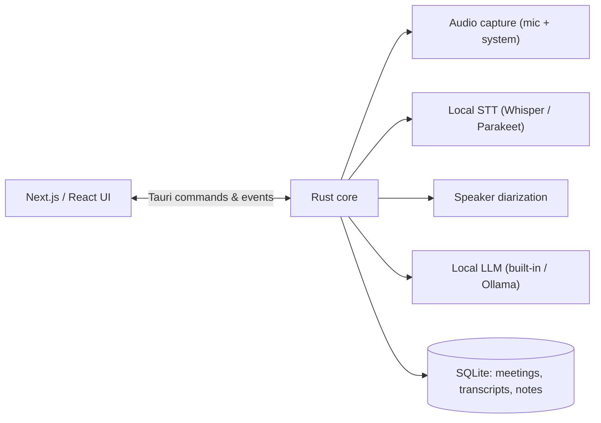

<p align="center">
  
</p>

<p align="center">
  <a href="https://github.com/praveenvnktsh/minutes/releases/latest"></a>
  
  
  
  
  
</p>

<p align="center">
  <b>Minutes</b> records your meetings, transcribes them locally, and writes notes while people talk, in the same document as yours.<br/>
  Audio, transcripts, notes, and summaries stay on your machine unless you explicitly configure an external AI provider.
</p>

<p align="center"><b><a href="https://praveenvnktsh.github.io/minutes/">praveenvnktsh.github.io/minutes</a></b></p>

---

## Screenshots

<p align="center">
  
</p>

<p align="center">
  
  
</p>

---

## Why Minutes

- **Notes while it happens, not a report after.** A model fine-tuned for meeting notes adds topics, points and decisions as people talk, next to your own lines, which it never rewrites. When the meeting ends, a second fine-tuned model writes the wrap-up: summary, decisions, action items, open questions.
- **Everything on-device.** Whisper/Parakeet transcription, speaker diarization, and the note models run on your Mac. No account, no cloud.
- **One screen from start to finish.** Hit record and the meeting workspace opens immediately — notes, live transcript, and chat live together with a floating record bar.

## Features

### Capture
- Record **microphone + system audio** together with professional mixing and clipping protection.
- **Live transcription** on demand, or transcribe after the meeting to stay light on CPU.
- Voice Activity Detection so only speech reaches the model.
- Detect supported meetings and offer to start recording automatically.
- Menu-bar state for idle, recording, and paused.

### The meeting workspace
- A single workspace from the moment you hit record — with a **floating record bar**.
- **One notes document**: type during the call; the AI's notes land in the same document, marked as its own. A **Show AI notes** switch hides them (copy and export follow it).
- Notes stay editable after the meeting, side by side with the transcript.
- **Live transcript dock** with search and color-coded speaker chips.
- **Ask your meeting**: a chat that can reference the transcript and your notes.
- **Collapsible** navigation rail and transcript/chat dock.
- **Responsive**: narrow windows collapse the rail and dock the transcript/chat at the bottom.
- **Light and dark** themes.

### Notes
- **Live AI notes** from Gemma 4 E2B with a LoRA trained for this job: every pause in the conversation it updates the notes with a few compact edits (new topic, point, decision, sub-bullet, fix or drop its own earlier note). Action items are left for the wrap-up, so it keeps up with live transcription on the same Mac.
- **The wrap-up** when the meeting ends, from a second LoRA on the same model: a short summary, decisions, action items with owners, and open questions, checked against the transcript (numbers must be grounded) before it is used. An owner the meeting never names is left out rather than guessed.
- Your own lines are never rewritten.
- The model **names the meeting**; the title stays inline editable.
- Both adapters are open: [live notes](https://huggingface.co/praveenvnktsh00/minutes-notes-gemma4-e2b) and [wrap-up](https://huggingface.co/praveenvnktsh00/minutes-tidy-gemma4-e2b) on Hugging Face (Apache 2.0, trained on the AMI Meeting Corpus). The app downloads them with the Gemma 4 E2B model.

### Transcription and models
- **Whisper.cpp / whisper-rs** and **NVIDIA Parakeet** paths, running locally.
- **GPU acceleration**: Metal + CoreML on Apple Silicon.
- **Built-in AI** models (Gemma 4 E2B for live notes, Qwen 3.5 for chat and summaries) plus **Ollama**.
- Optional external providers (**Claude, Groq, OpenRouter**) when you configure them.
- **Speaker diarization** with an editable speaker manager and reassignment.
- **Import audio** and retranscribe; background transcription queue.

### Data
- Meetings, transcripts, and notes stored locally in **SQLite**.
- Full-text transcript search and a meetings list with dates.
- Signed desktop updates.

## Download

Click to download the latest version directly:

| Platform | Download |
| --- | --- |
| **macOS** (Apple Silicon) | [**minutes-macos-arm64.dmg**](https://github.com/praveenvnktsh/minutes/releases/latest/download/minutes-macos-arm64.dmg) |

All releases and notes: [github.com/praveenvnktsh/minutes/releases/latest](https://github.com/praveenvnktsh/minutes/releases/latest).
**Minutes is Mac-only: Apple Silicon, macOS 13 or later.** Windows and Linux are not supported, and the code no longer builds for them.

> **macOS first launch:** Minutes isn't notarized yet, so macOS may warn that it "could not verify it is free of malware". To open it, **right-click the app → Open → Open**, or run `xattr -dr com.apple.quarantine /Applications/minutes.app` once.

## Quick start

On an Apple Silicon Mac, install Rust, Node.js, pnpm 9.15.9, and Xcode (select it with `xcode-select`).

```bash
git clone https://github.com/praveenvnktsh/minutes.git
cd minutes/frontend
pnpm install --frozen-lockfile
pnpm tauri:dev
```

Local Apple Silicon production bundle with Metal:

```bash
cd frontend
pnpm tauri:build:local:mac
```

See [docs/BUILDING.md](docs/BUILDING.md) for details.

## Architecture



Minutes is a Tauri 2 desktop app: a Next.js/React interface inside a Rust core. Rust handles audio capture, local inference, persistence, notifications, meeting detection, and updates; all meeting data lives in a local SQLite database. See [docs/architecture.md](docs/architecture.md).

## Privacy

Usage telemetry is disabled and no analytics destination is configured. Audio, transcripts, notes, and summaries stay on your machine. If you configure an external AI provider, the data sent to it is governed by that provider's terms and your configuration. Read the [privacy policy](PRIVACY_POLICY.md).

## Updates

The desktop updater reads signed manifests from this repository's releases:

`https://github.com/praveenvnktsh/minutes/releases/latest/download/latest.json`

Release artifacts are signed with this fork's Tauri updater key; the private key lives outside the repository and in CI secrets.

## Contributing

Issues and pull requests are welcome — see [CONTRIBUTING.md](CONTRIBUTING.md).

## License and acknowledgments

Minutes is distributed under the [MIT License](LICENSE.md). The original MIT copyright notice is retained as required by that license. Third-party code, libraries, and models retain their respective licenses and attribution.

Built on open-source work including [whisper.cpp](https://github.com/ggerganov/whisper.cpp), [Screenpipe](https://github.com/mediar-ai/screenpipe), and NVIDIA Parakeet model tooling.
